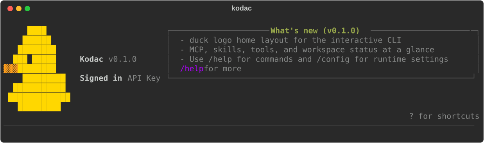

# Kodac

Kodac 是一个运行在终端里的 AI Agent CLI。它在当前工作目录中读写文件、搜索代码、执行命令、联网检索、调用 MCP 工具，并维护跨会话的长期记忆；同时通过 Runtime API 把 thread、turn、事件和后台任务暴露给外部系统。



- 三条执行路径（ReAct / Plan-and-Execute / Multi-Agent）共用同一套工具、策略、记忆和快照能力
- 默认保留人工确认、路径与命令守卫、JSONL 审计日志
- 基于 OpenAI-compatible 流式协议，默认面向 DeepSeek 配置
- Python 3.11+，依赖 `uv`、`rich`、`prompt-toolkit`

## 功能特性

**执行模式**

- **ReAct**：单轮内交替进行 thinking、tool call、tool result 和 final output，直到任务完成
- **Plan-and-Execute**：独立 Planner 生成任务 DAG，按依赖批次调度，同批次任务可并行执行
- **Multi-Agent**：Planner / Worker / Reviewer 协作，支持依赖调度、并行 worker、review 重试，子 Agent 可独立切换到 Plan 模式

**工具与联网**

- 文件读写、目录树、glob、grep、代码搜索、Shell 命令执行
- `web_search` 通过 DuckDuckGo HTML 检索；`web_fetch` 抓取页面并提取正文，拒绝 `file://`、loopback、私有网段，降低 SSRF 风险
- 本地与远程图片输入，按模型多模态能力自动降级为文本元信息

**记忆与上下文**

- 三层记忆：当前会话短期上下文、人工维护的静态长期上下文（`KODAC.md`）、按项目隔离的 SQLite 动态记忆
- 动态记忆按当前问题召回 Top-K，带元数据、去重哈希、TTL、容量淘汰和访问计数
- Prompt 拆成可缓存的静态前缀与逐请求重建的动态后缀
- 上下文达到可用预算 80% 时压缩旧轮次，压到约 55%，保留近期消息和完整工具调用对

**Skill**

- 按 `builtin → user → project` 三层加载，同名时后层覆盖前层
- 每轮输入先做中英文词法 / n-gram Top-K 匹配，把候选交给模型决定是否 `load_skill`
- `save_skill` 必须经人工确认，默认拒绝覆盖已有 Skill

**安全与可观测**

- HITL 人工确认、`PathGuard` 工作区限制、`CommandGuard` 命令拦截、JSONL 审计日志
- `Default` 与 `Auto (full access)` 两种会话权限模式，后者仅当前会话生效，切回即恢复启动策略
- 完整 usage：输入/输出、cache hit/miss、reasoning token 和可配置成本估算
- Agent run 前后自动创建快照，支持 `/restore` 恢复现场

## 架构

### 三条执行路径

| 路径 | 入口模块 | 触发方式 |
| --- | --- | --- |
| ReAct | `agent/agent.py` | 默认交互、`-p` |
| Plan-and-Execute | `agent/plan_execute.py` | `/plan`、`--mode plan` |
| Multi-Agent | `agent/orchestrator.py` | `/team`、`--mode team` |

三条路径共享工具注册表、策略引擎、记忆、Skill 和快照；SDK 与 Runtime API 也复用同一套引擎，不存在只为某一条路径生效的能力。

### 模块划分

```text
src/kodac/
├── agent/       ReAct、Plan-and-Execute、Multi-Agent 编排
├── entrypoints/ Typer CLI 与 prompt-toolkit REPL
├── llm/         模型抽象、OpenAI-compatible 客户端、usage/cost
├── tools/       工具定义、执行器、文件与命令操作
├── policy/      PathGuard、CommandGuard、AuditLog
├── prompt/      静态 Prompt 与逐请求动态上下文
├── context/     上下文预算与压缩
├── memory/      SQLite 长期记忆、召回与治理
├── skill/       builtin/user/project Skill 发现与注入
├── plan/        计划、任务与 DAG
├── mcp/         MCP Client、Server 与动态工具注册
├── runtime/     Thread/Turn API 与持久化任务队列
├── render/      Rich / 纯文本终端渲染
├── snapshot/    执行前后快照与恢复
├── rag/         本地代码索引与搜索
└── web/         联网搜索与页面抓取
```

### 一次请求的数据流

```text
用户输入
  → Skill Top-K 匹配
  → Prompt 组装（静态前缀 + 动态后缀）
  → LLM 流式响应（thinking / tool_call / usage 事件）
  → ToolExecutor（只读判定 → 危险级别 → HITL → PathGuard/CommandGuard → 审计）
  → 上下文预算检查（超限则压缩）
  → 渲染 / 快照
```

## 环境要求

- Python 3.11 或更新版本
- [uv](https://docs.astral.sh/uv/)
- 可选：`rg`，用于更快的本地搜索
- 可选：Chrome DevTools MCP 需要 Node.js 20.19.0 LTS 或更新版本、npm/npx 和 Chrome

## 安装

**全局安装**：装一次，之后在任意目录直接运行 `kodac`。

```bash
uv tool install git+https://github.com/rommelida722-boop/Kodac-Python.git
```

从本地克隆安装（`--editable` 表示改源码立即生效）：

```bash
git clone https://github.com/rommelida722-boop/Kodac-Python.git
uv tool install --editable ./Kodac
```

用 `pip` 系工具同样可以：

```bash
pipx install ./Kodac              # 普通安装
pipx install -e ./Kodac           # 开发模式，改源码立即生效
pip install --user ./Kodac
```

安装位置是 `uv tool dir --bin` 输出的目录，需确保它在 `PATH` 上。升级与卸载：

```bash
uv tool upgrade kodac
uv tool uninstall kodac
```

**源码开发模式**：

```bash
git clone https://github.com/rommelida722-boop/Kodac-Python.git
cd Kodac
uv sync --extra dev
uv run kodac --help
```

## 快速开始

```bash
kodac                                    # 交互模式
kodac -p "帮我总结这个项目"               # 单次提问
kodac --mode plan -p "先读取 README，再验证项目" --json
kodac --mode team --worker-mode plan -p "并行审计核心模块" --json
kodac doctor --cwd .                     # 检查 Python、uv、Node、API Key 和配置路径
```

## 配置

配置优先级从低到高：

1. 内置默认配置
2. `~/.kodac/config.json`
3. 项目级 `.kodac/config.json`
4. 项目级 `.env`
5. CLI 参数
6. 当前进程环境变量

在项目根 `.env` 中配置：

```dotenv
KODAC_PROVIDER=deepseek
KODAC_MODEL=deepseek-v4-flash
DEEPSEEK_API_KEY=your_key_here
```

也可以使用通用 Key `KODAC_API_KEY`。支持的 provider-specific Key：`DEEPSEEK_API_KEY`、`ZAI_API_KEY`（GLM 官方推荐）、`GLM_API_KEY`、`STEP_API_KEY`、`KIMI_API_KEY`。

命令行临时覆盖：

```bash
kodac --provider deepseek --model deepseek-v4-flash
```

连接本地 OpenAI-compatible 服务：

```bash
KODAC_PROVIDER=openai-compatible \
KODAC_BASE_URL=http://127.0.0.1:11434/v1 \
KODAC_MODEL=qwen2.5-coder \
kodac -p "解释这个仓库"
```

默认 provider/model 是 `deepseek/deepseek-v4-flash`。DeepSeek V4 Flash/Pro 内置 1M 上下文与官方价格表；价格会变动，可用 `llm.context_window` 和 `llm.prices` 覆盖。未收录的 OpenAI-compatible 模型应显式配置上下文窗口与价格。

## 交互命令

| 分类 | 命令 |
| --- | --- |
| 会话 | `/help` `/exit` `/clear` `/context` `/config` `/usage` |
| 规划 | `/plan <task>` `/team <task>` `/team --plan <task>` |
| 模型 | `/model` `/model <model-id>` `/model <provider> <model-id>` |
| 记忆 | `/memory` `/memory search <q>` `/memory stats` `/memory delete <id>` `/memory clear` `/save <fact>` |
| 代码索引 | `/index [path]` `/search <query>` |
| Skill | `/skill` `/skill list` `/skill show <name>` `/skill on/off <name>` `/skill reload` |
| 安全 | `/hitl default\|auto` `/policy` `/audit [N]` `/tools` |
| 集成 | `/mcp` `/task` `/task add <task>` `/task cancel <id>` `/task log <id>` |
| 快照 | `/snapshot` `/snapshot clean` `/restore <id\|index>` |

`/model` 打开交互式选择器：`Tab` 在 `Default` 与 `Custom` 间切换，方向键选模型，`Enter` 立即切换当前 Agent。`Custom` 支持选择已保存的 BYOK 配置、新建 DeepSeek/GLM/OpenAI-compatible 配置或按 `d` 删除。自定义配置保存在 `~/.kodac/models.json`；建议填写 API Key 环境变量名，只有显式输入密钥时才写入该文件。

交互模式下按 `Shift+Tab` 在 `Default` 与 `Auto (full access)` 之间切换。`Auto` 在当前会话内不再请求审批，并关闭路径与命令守卫；再次切换即恢复启动时的策略。

## 内置工具

| 类别 | 工具 |
| --- | --- |
| 文件 | `read_file` `write_file` `edit_file` `list_dir` `directory_tree` `get_file_info` |
| 搜索 | `glob` `glob_files` `grep` `grep_code` `search_code` |
| 执行 | `bash` `execute_command` |
| 联网 | `web_search` `web_fetch` |
| 记忆 | `save_memory` `search_memory` |
| Skill | `load_skill` `save_skill` |
| 历史 | `revert_turn` |

写文件、执行命令、远程 MCP 写操作、恢复快照等危险动作统一经过 policy、HITL 和审计；`save_skill` 同样强制人工确认。非交互入口不会因为缺少审批界面而静默放行危险操作。

## MCP

Kodac 可以连接 MCP server，并把远端工具注册为 `mcp__<server-name>__<tool-name>`，支持 stdio 与 Streamable HTTP 两种传输。

```bash
kodac mcp init-chrome --scope project    # 生成 .kodac/mcp.json
kodac mcp init-chrome --scope project --browser-url http://127.0.0.1:9222
kodac mcp list
```

把 Kodac 自身作为 MCP server 暴露：

```bash
kodac mcp serve --transport stdio
kodac mcp serve --transport http --port 3000
```

> MCP server 以子进程方式启动，会继承当前进程的环境变量。只接入可信的 MCP server。

## Runtime API

```bash
KODAC_RUNTIME_API_KEY=dev-key kodac serve --http --port 8080
```

```bash
# 创建线程
curl -sS -X POST http://127.0.0.1:8080/v1/threads -H 'x-api-key: dev-key'

# 发送 turn
curl -sS -X POST http://127.0.0.1:8080/v1/threads/<thread_id>/turns \
  -H 'content-type: application/json' -H 'x-api-key: dev-key' \
  -d '{"message":"总结这个项目"}'

# 读取事件
curl -sS http://127.0.0.1:8080/v1/threads/<thread_id>/events -H 'x-api-key: dev-key'

# 创建后台任务
curl -sS -X POST http://127.0.0.1:8080/v1/tasks \
  -H 'content-type: application/json' -H 'x-api-key: dev-key' \
  -d '{"message":"后台总结这个仓库","mode":"plan"}'
```

也可以只启动队列消费者，不暴露 HTTP：

```bash
kodac worker --workers 2 --cwd .
```

任务队列按项目目录隔离，worker 通过 SQLite 原子事务领取任务，并用 lease/heartbeat 恢复崩溃任务；运行中取消会阻止迟到结果被重新写回 `completed`。

## SDK

```python
from kodac.sdk import create_default_engine

engine = create_default_engine(cwd=".")
print(engine.ask_complete("解释这个项目").text)

engine.plan_complete("先读取 README，再总结项目结构")
engine.team_complete("让多个 Agent 并行检查核心模块")
```

## 开发

```bash
uv sync --extra dev
git config core.hooksPath .githooks   # 启用提交前凭据扫描
```

检查：

```bash
uv run --extra dev python -m ruff check .
uv run --extra dev python -m ruff format --check .
uv run --extra dev python -m pytest
uv build
```

冒烟：

```bash
uv run kodac --version
uv run kodac --help
uv run kodac doctor --cwd .
uv run kodac --plain -p hello
```

提交前钩子会拦截暂存内容中形如 `sk-`、`AKIA`、`ghp_` 的密钥；确认是测试假数据时可用 `git commit --no-verify` 跳过。

## License

MIT，见 [LICENSE](LICENSE)。


### 第一期：长上下文完整性

修复无用户消息历史的工具调用压缩边界，深拷贝嵌套消息数据。上下文回归测试 7 项通过，详见 docs/releases/phase-01-context-integrity.md。
