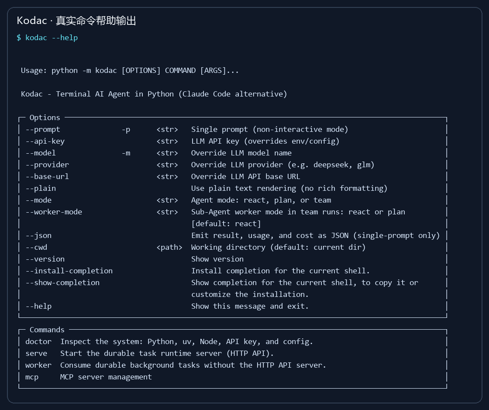
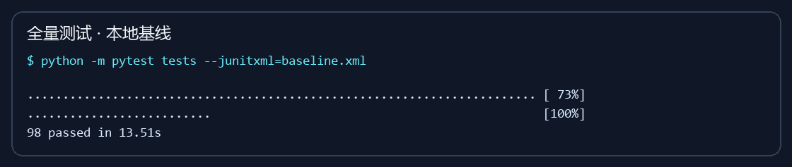
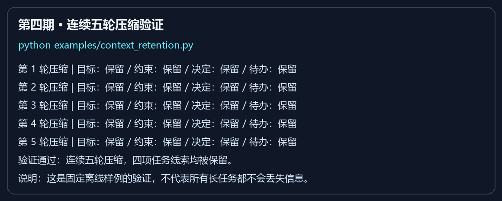

# Kodac 项目图文介绍

Kodac 是使用 Python 编写的终端 AI 编程助手。它把模型推理与项目中的文件、命令、工具和长期记忆连接起来，并提供 CLI、SDK、MCP Server 与 Runtime API 入口。

## 从一条命令开始



上图来自本轮真实执行 `python -m kodac --help` 的输出，经排版生成图片；不是模型回答效果演示，也不是桌面截屏。

在配置好模型 API Key 后，可以直接问项目问题、先规划再执行，或使用团队模式分解任务：

```powershell
uv run kodac -p "解释这个项目的结构"
uv run kodac --mode plan -p "先规划，再修复测试失败"
uv run kodac --mode team -p "检查项目中的潜在问题"
```

建议初次使用保留默认权限模式，查看工具执行提示后再确认。日常工作不需要把 API Key 写进代码或提交到 GitHub。

## 项目能力

| 能力 | 作用 | 主要模块 |
| --- | --- | --- |
| ReAct | 根据模型输出调用工具，再把结果交回模型 | `agent/agent.py` |
| 规划执行 | 将任务组织为有依赖关系的步骤 | `agent/plan_execute.py` |
| 团队编排 | Planner、Worker、Reviewer 协作 | `agent/orchestrator.py` |
| 工具与策略 | 文件读写、检索、命令执行与审批 | `tools/`、`policy/` |
| 记忆与上下文 | 召回长期记忆，压缩历史，保留工具调用完整性 | `memory/`、`context/` |
| Skill | 发现相关技能，按需加载正文 | `skill/` |
| MCP | 连接外部工具，也能对外提供工具 | `mcp/` |
| Runtime | 提供线程、轮次、事件和持久化后台任务 | `runtime/` |
| 快照 | 保存执行前后现场，支持恢复 | `snapshot/` |

一次请求的处理流程：用户输入 → 技能匹配与上下文组装 → 模型响应 → 工具审批与执行 → 结果回传 → 继续推理或输出答案。

## 测试基线



2026-11-02，本地 Windows / Python 3.12.9 下完整测试集 98 项通过，无失败、无跳过。上图由实际测试日志渲染；原始 JUnit 报告随本期交付保留。

GitHub Actions 配置在每次推送后运行全量测试，并覆盖 Windows、Linux 和 Python 3.11—3.13。远端各组合的最终结果以仓库 Actions 页面为准。

完整测试采用离线客户端和本地测试服务；真实模型效果、外网检索、Chrome MCP 环境仍需配置后验证。

## 每期如何保留

每期使用独立提交、独立标签与更新记录。已整理的期次参见 [CHANGELOG](../CHANGELOG.md)，本轮测试与 CI 细节参见 [第二期记录](releases/phase-02-ci-baseline.md)。

原仓库继承的许可证和既有项目来源继续保留，新增实现仍然使用 Python。


## 第四期新增：重复压缩中的任务线索

0.1.1 版本使用结构化抽取摘要，重点保留目标、约束、决定和待办，并保留来源与历史顺序。全量测试现为 112 项；前文的 98 项结果是第二期历史基线。



上图来自 `examples/context_retention.py` 的实际输出渲染。该固定样例五轮验证均通过；这不代表所有长任务均不会丢失信息。详情见 [第四期记录](releases/phase-04-context-retention.md)。
