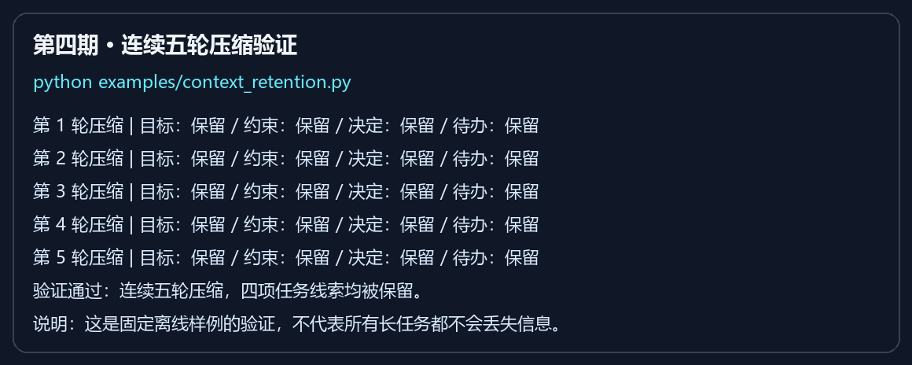

# 第四期：长上下文压缩质量（0.1.1）

## 原来的问题

旧压缩器主要截取每条旧消息的开头。长消息尾部的待办可能丢失；旧摘要再次压缩时会被当作普通文本继续截断；缩短摘要时直接切字符串，还可能丢失结束标记。

## Python 实现

新增 `context/summary.py`，由原有 `ContextWindowManager` 统一调用：

- 按句子和换行抽取目标、约束、待办、决定、结果、文件和一般记录。
- 在预算允许时，优先保留最早的目标与各类别最近的线索，重复日志去重。
- 选择按重要性进行，输出保留历史顺序，避免再次压缩时颠倒新旧约束。
- 摘要条目保存原消息角色；工具输出继续标记为工具来源。
- 重复压缩时解包已有条目，不反复套用和截断摘要说明。
- 兼容完整旧版摘要；对于以工具名称标记的旧条目保留工具来源。
- 按实际 JSON 序列化长度分配字符预算，始终保留完整边界；缩短摘要时重新选择条目。
- 转义条目中的尖括号和换行，避免消息内容伪造新的摘要条目或边界。
- 多模态历史保留文字任务线索，不将图片 base64 写入摘要；近期原消息仍按原策略保留。

没有新增模型调用、网络依赖或长期记忆写入。ReAct、规划执行与团队模式中复用查询循环的入口共享这项改进。

## 离线示例与输出图

```powershell
uv run --frozen --extra dev python examples/context_retention.py
```



上图由本轮实际执行的示例输出渲染，不是桌面截屏或真实模型回答效果演示。每轮均检查四项任务线索；任何检查失败都会以非零状态退出。

## 固定样例的旧版对照

使用同一组目标、约束、决定、待办和相同的五轮历史增长，分别运行第三期原实现与本期实现：旧版最终保留 0/4 项指定线索，本期保留 4/4 项；长消息尾部待办由旧版未保留变为本期保留。这是固定样例对照，不能外推为任意任务的准确率。

## 验证

- 全量测试：112 项通过、0 失败、0 跳过；较上期新增 14 项回归用例。
- 中英文任务连续五轮压缩后仍保留预期目标、约束、决定与待办。
- 覆盖长消息尾部线索、小预算、重复日志、摘要边界、旧版摘要、多模态文字、新旧约束顺序，以及 QueryEngine 公开入口。
- Ruff 检查和格式检查通过，锁文件一致性检查通过。
- Actions 保留六组跨平台测试矩阵，并对每组额外执行本期离线示例。
- 发行版本：0.1.1；Git 标签：`phase-04-context-retention`。

远端执行结果以相应提交的 Actions 记录为准。

## 实际边界

这是基于规则的抽取式压缩，不是语义完整性的保证。极小预算会丢弃部分历史；已被旧版摘要截掉的信息无法恢复；摘要中的待办和结果是历史线索，不自动推断哪些任务已经完成。近期原文和用户的新指令仍是判断当前任务状态的依据。

如果系统提示、工具定义和近期消息本身已经超过预算，本期不会通过删除近期消息或拆散工具调用来强行满足目标。真实模型回答质量仍需另行评估。
