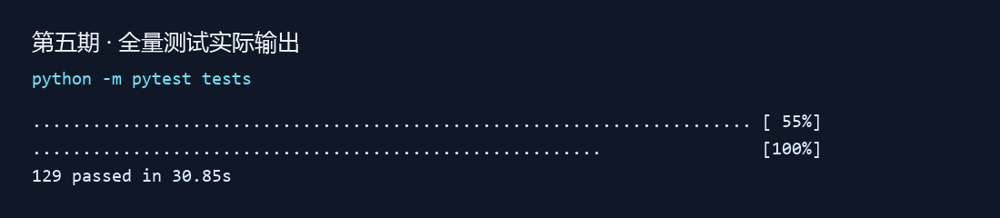

# 第五期：后台任务可靠性（0.1.2）

## 修复内容

- 租约过期后，原 Worker 不再允许续租、完成或失败回写；过期任务仍可由其他 Worker 回收。
- 复用原有 attempts 领取序号作为执行轮次凭据，防止同名 Worker 重领后，旧轮次覆盖新轮次。
- Runtime 的心跳、成功与失败链路均传递领取序号；状态更新使用 SQLite 条件更新，在数据库中校验所有者、轮次、运行状态与有效租约。
- 未提供所有者的旧完成接口仅兼容首次匿名领取，不能覆盖命名 Worker 或重领后的任务。
- 沿用已有项目隔离与取消语义，不新增数据库字段或网络依赖。

## 验证结果

新增 17 项回归用例，全量测试由 112 项增至 129 项，全部通过。

覆盖过期续租、迟到完成、迟到失败、同名重领、缺少领取序号、匿名旧调用、正常续租、中断后恢复和取消后写入。跨进程用例采用 spawn 启动 4 个独立进程，竞争 12 个任务，结果为 12 个不同任务完成、无重复领取、每个任务领取次数为 1；这是一组固定竞争用例，不是吞吐量基准或任意故障下的恰好一次保证。

公开链路用例运行真实 Runtime Worker 循环，使用离线任务验证领取序号已接入完成回写，不依赖真实模型。



图片由实际测试日志渲染，不是桌面截屏。远端结果以本期 Actions 记录为准。

## 调用方式与兼容性

命名 Worker 调用 heartbeat、complete、fail 时必须提供本次 TaskRecord.attempts，否则返回 False：

```python
# 从原子领取结果取得执行轮次，不自行构造或重用旧序号。
task = manager.claim_next("worker-1")
if task:
    manager.complete(task.id, "执行结果", worker_id="worker-1", attempt=task.attempts)
```

首次匿名领取的旧完成调用继续兼容；匿名任务被回收后，也必须显式传入所有者和当前序号。任务数据库表结构不变。

## 实际边界

本期保护任务状态与结果的回写，不承诺任务或外部副作用恰好执行一次。崩溃恢复可能重新执行任务；已经发出的模型请求或工具操作不能通过数据库取消自动撤回。调用外部写服务时，仍应设计幂等键或补偿策略。

标签：phase-05-task-reliability；版本：0.1.2。
